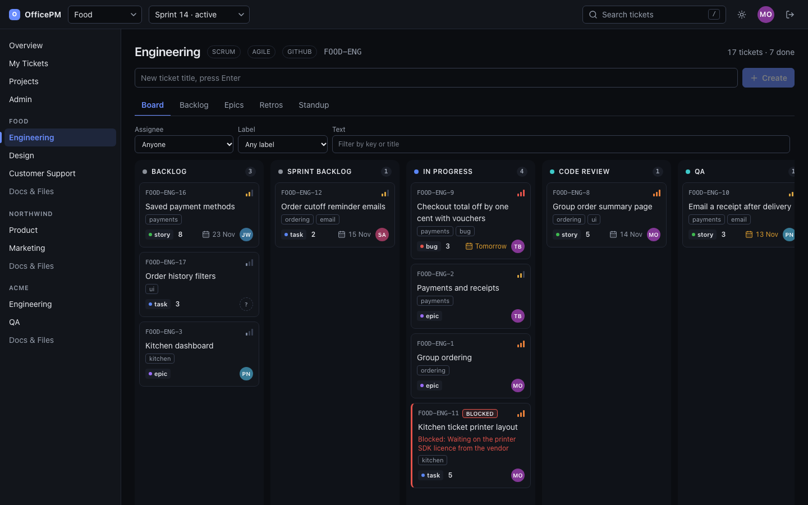
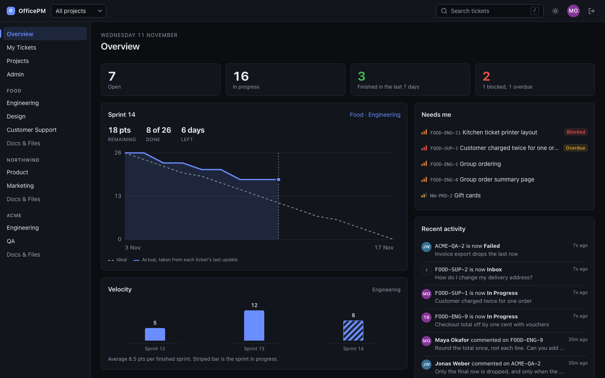
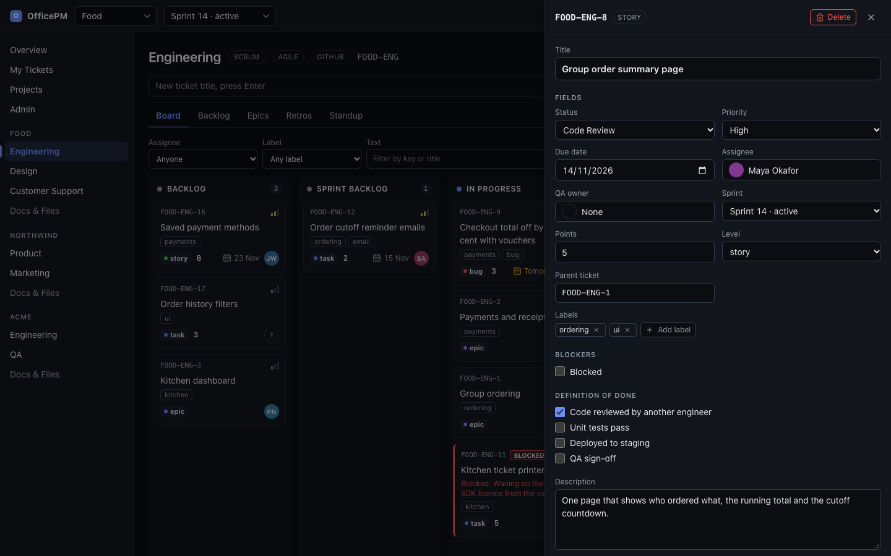
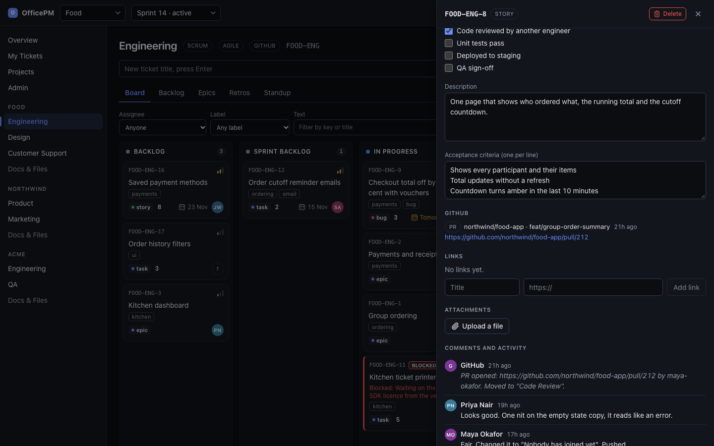
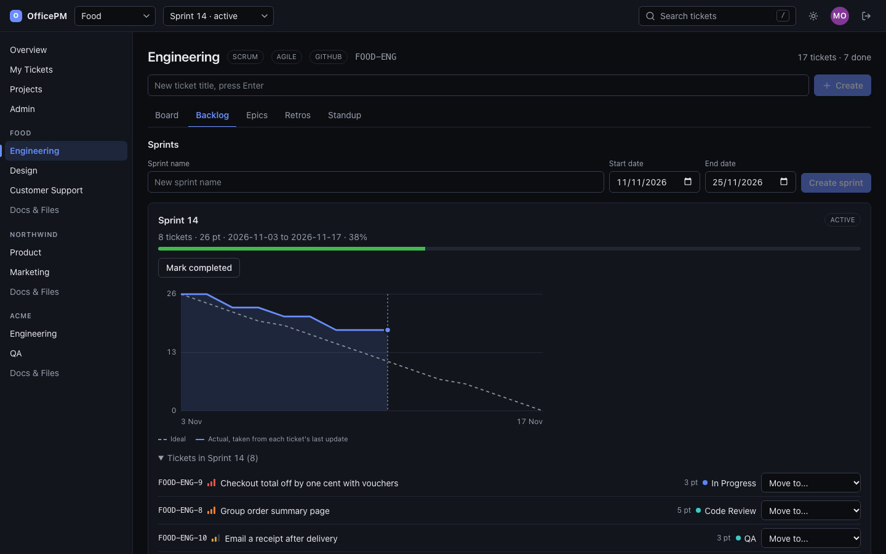
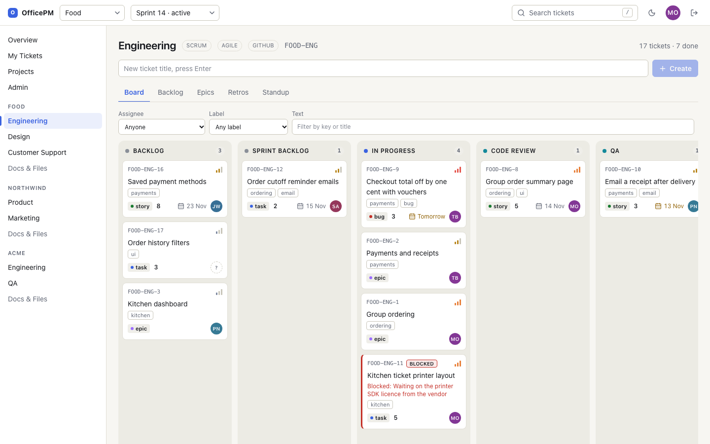
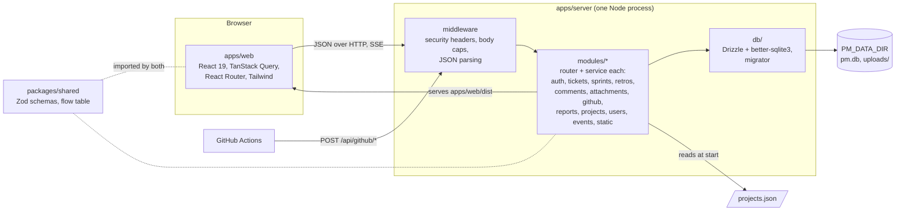

# OfficePM

Self-hosted project management for a small office. One server process, one SQLite
file, and a React client the server hands out itself. No cloud services, no
accounts with anyone, nothing to pay for.

It runs five workflow methodologies (Kanban, Scrum, Scrumban, Shape Up,
Waterfall), an opt-in agile layer on any of them, and GitHub webhooks that move
tickets on PR open, deploy and release, so engineering status updates itself.



> **This is v2**, a TypeScript rewrite: `apps/server` (Hono, Drizzle, SQLite),
> `apps/web` (React), `packages/shared` (the Zod contract both sides import). The
> original v1 is kept untouched in `legacy/` as the oracle the rewrite is tested
> against, and v2 opens a v1 `pm.db` as it is. Status of the rewrite and what is
> left before it replaces v1 is in [docs/ARCHITECTURE-PLAN.md](docs/ARCHITECTURE-PLAN.md).

## Quick start

You need Node 22 or newer and pnpm 10 (`corepack enable` picks the version from
`package.json`, or `npm install -g pnpm@10`). The native modules (`better-sqlite3`,
`bcrypt`) come as prebuilt binaries where one exists and compile otherwise, which
needs Python, make and a C++ compiler.

### From source, with the demo workspace

```bash
pnpm install
pnpm seed          # demo data into .data/ (about 30 tickets, 6 users, 7 boards)
pnpm dev           # builds, then serves the app on http://localhost:3000
# sign in as maya.okafor@officepm.demo / demo-password
```

`pnpm dev` and `pnpm seed` use `.data/` in the repository, never a `pm.db` sitting
in the repo root. The demo password is public, so only seed a machine you do not
expose. For live reload of the client, leave `pnpm dev` running and start
`pnpm dev:web` in a second terminal: Vite serves the client on
http://localhost:5173 and proxies `/api` to port 3000.

Without the seed, the first start creates an admin account instead. Set
`ADMIN_EMAIL` and `ADMIN_PASSWORD` first, or the server prints a generated password
once, which you must copy down.

### From source, for real use

```bash
pnpm install && pnpm build
cp .env.example .env     # set PM_TOKEN, ADMIN_PASSWORD, and PM_DATA_DIR to a directory of its own
PM_DATA_DIR=/var/lib/officepm ADMIN_PASSWORD=choose-one PM_TOKEN=a-long-random-string pnpm start
```

`pnpm build` compiles the server and bundles the client; `pnpm start` serves the
bundle from `apps/web/dist`. Leaving `PM_DATA_DIR` unset puts `pm.db` in the
repository root, where v1 kept it. Set it. `ROLLOUT.md` has the systemd unit.

### With Docker

```bash
cp .env.example .env     # set PM_TOKEN and ADMIN_PASSWORD
docker compose up -d --build
curl http://127.0.0.1:3000/api/health      # {"ok":true}
```

The image is a multi-stage build on `node:24-bookworm-slim` (pinned by digest),
runs as the unprivileged `node` user with a read-only root filesystem, and has a
healthcheck. `pm.db` and `uploads/` live in the volume `officepm-data`, so
rebuilding never touches them. The port is published on `127.0.0.1` only; see the
config table to change that. To load the demo workspace into a fresh volume, run
this before the first `up`:

```bash
docker compose run --rm officepm node apps/server/dist/seed-main.js
```

Seeding creates the demo users, so the first-boot admin is then not created. Sign
in as Maya, who is an admin.

## What it does

**Boards you can drag.** Move a ticket by dragging it to another column, with the
card jumping at once and snapping back with the reason if the board refuses the
move. From the keyboard, focus a card, press Space, choose a column with Left and
Right, press Space again. On a phone a long press picks the card up. Cards show
assignee, priority, labels, points and due date.



**Projects and boards.** Multiple projects, each with its own boards, each board
with its own workflow. Boards are declared in `projects.json`, not in the
database, so changing the team's process is a text edit and a restart.

**Five flows.** A board picks Kanban, Scrum, Scrumban, Shape Up or Waterfall and
the UI adapts. Waterfall boards refuse to skip a phase. Scrum and Scrumban get
sprints, burndown and velocity. Shape Up gets 6-week cycles and 2-week cooldowns.

**An agile layer, opt in per board.** Epics and stories, acceptance criteria,
Definition of Done and Definition of Ready, retros created automatically when a
sprint completes, a standup view, and blockers. A team that does not want any of it
is not shown any of it.



**GitHub integration.** Three webhook endpoints for GitHub Actions. A PR opening
moves its ticket to Code Review and posts a comment, a deploy moves it to QA or
Done depending on environment, and a release moves everything named in the
changelog. Ticket keys are read out of branch names and commit messages. Boards
without `has_github` are never touched by CI. On a Waterfall board a webhook obeys
the same no-skipping rule as a person.



**Sprints, burndown, velocity.**



**Docs, links and file uploads** scoped to a project or a ticket, with limits (25 MB
per file, 20 per ticket, 100 per project), an extension blocklist, uuid filenames on
disk, and downloads that always serve as an attachment and always require a session.

**Real-time.** Server-Sent Events, so a ticket someone else moves appears
immediately without polling.

**Keyboard first.** `Ctrl/Cmd+K` command palette, `/` to search, `J` and `K` to
move through tickets, `Enter` to open, `E` to edit, `A` to assign to yourself, `G`
then `B`, `S` or `R` to jump, `C` to create. `?` lists them all. Light and dark
themes, and a layout that works on a phone.



## How it is put together



The server is a Hono app. Each feature is a folder under
`apps/server/src/modules/` holding a router (parse the request, call the service,
shape the response) and a service (the rules, and the SQL). The database is the one
v1 created: the migrator in `apps/server/src/db/` applies additive migrations and
records them in a table of its own, so a v1 `pm.db` opens unchanged. The client
validates every response against the same Zod schemas the server tests use, so a
handler that drifts from the contract fails a test rather than a screen.

### Project layout

| Path | What |
|---|---|
| `apps/server/src/` | The server: `app.ts` (middleware and routes), `main.ts` (entry), `config.ts`, `projects-config.ts`, `bootstrap.ts`, `backup.ts`, `seed-main.ts` |
| `apps/server/src/modules/<name>/` | One feature each: `routes.ts` and `service.ts` |
| `apps/server/src/http/` | Cross-cutting HTTP code: auth guard, body and size limits, login throttle, security headers, validation |
| `apps/server/src/db/` | Drizzle schema, migrations, migrator, upload path resolver |
| `apps/server/src/seed/` | The demo workspace (`demo-data.ts`) and the code that writes it |
| `apps/web/src/` | The client, one folder per product area under `features/`; see `apps/web/README.md` |
| `apps/web/e2e/` | Playwright specs, one per view, plus axe and the security headers |
| `packages/shared/src/` | The contract: entity, request and response schemas, and the flow capability table |
| `tests/conformance/` | The 104 HTTP-level tests, run against either server |
| `tests/data-compat/` | Proof that v2 opens v1 databases and that v1 still runs on them afterwards |
| `legacy/` | The frozen v1 server and client |
| `projects.json` | Project and board definitions, the source of truth, not the database |
| `Dockerfile`, `docker-compose.yml` | The container image and a one-machine deployment |
| `PRD.md` | The specification v1 was built against |
| `ROLLOUT.md` | Hosting, Tailscale, GitHub Actions, backups, upgrades, and a user guide |

## Configuration

All configuration is environment variables.

| Variable | Default | What |
|---|---|---|
| `PORT` | `3000` | Port the server listens on (inside the container too; the compose file maps it) |
| `PM_DATA_DIR` | repository root (image: `/data`) | Directory holding `pm.db` and `uploads/`. Set it to a directory of its own. |
| `PM_PROJECTS_FILE` | `projects.json` in the repository root | Project and board definitions. The server refuses to start if it is malformed. |
| `PM_WEB_DIR` | `legacy/` (`pnpm start`: `apps/web/dist`; image: `/app/apps/web/dist`) | Directory the client is served from. The raw default is the v1 client. |
| `PM_TOKEN` | empty | Shared secret for the GitHub webhooks (`x-pm-token` header). Empty disables them. |
| `ADMIN_EMAIL` | `admin@officepm.local` | First-boot admin, used only while the users table is empty |
| `ADMIN_PASSWORD` | generated, printed once | Password for that admin |
| `PM_TRUST_PROXY` | off | `1` or `true` behind a reverse proxy, so the login throttle uses the address in `X-Forwarded-For`. Leave off when reached directly: a client could forge it. |
| `NODE_ENV` | `development` | Only printed at startup |
| `PM_HOST_BIND`, `PM_HOST_PORT` | `127.0.0.1`, `3000` | docker compose only: where the container is published on the host |

`pnpm start` loads no `.env` file. Put variables in the shell, or run
`node --env-file=.env apps/server/dist/main.js` (then set `PM_WEB_DIR` too).
docker compose reads `.env` itself.

## Commands

| Command | What |
|---|---|
| `pnpm build` | Compile the server and bundle the client |
| `pnpm start` | Run the server (`PM_DATA_DIR` as given) |
| `pnpm dev` | Build, then run against `.data/` |
| `pnpm dev:web` | Vite dev server for the client on :5173 |
| `pnpm seed` | Demo workspace into `$PM_DATA_DIR` (default `.data/`) |
| `pnpm backup [dir]` | Consistent snapshot of the data directory, safe while the server runs |
| `pnpm lint`, `pnpm format:check`, `pnpm typecheck` | Static checks |
| `pnpm test` | Conformance (v1), unit, data-compat |
| `pnpm test:conformance:v2` | The conformance suite against the v2 server |
| `pnpm test:e2e` | Browser suite (needs `pnpm --filter @officepm/web exec playwright install chromium` once) |

## Tests

Four layers, each aimed at a different failure.

- **Conformance, the oracle.** `tests/conformance/` holds 104 tests on Node's
  built-in runner. They boot a real server in a child process against a throwaway
  data directory and talk to it over HTTP, because what is worth testing (session
  cookies, multipart uploads, `Content-Disposition`, webhook tokens) only exists at
  that boundary. The server under test is chosen by `OFFICEPM_SERVER_CMD` and the
  seed script by `OFFICEPM_SEED_CMD`. By default they run against v1 in `legacy/`,
  which defines the behaviour; `pnpm test:conformance:v2` runs the same 104 against
  the v2 server, and both must pass all 104. CI fails if the count is anything else.
  These tests are the contract and are never weakened to make a change pass.
- **Unit** (`pnpm test:unit`, Vitest). The server in-process with every response checked
  against the shared Zod schemas, the hardening rules, the backup and the seeder
  (which is also compared row for row with v1's seed script), the shared package, and the
  web client's components.
- **Data compatibility** (`pnpm test:data-compat`). Builds databases with v1's own
  code (empty, seeded, an old column shape, uploads moved to another directory),
  opens them with v2, and checks that no row changed, that v1 still boots and logs
  in on the result, and that stored upload paths resolve.
- **End to end** (`pnpm test:e2e`). A real browser against a seeded v2 server:
  every screen's flows, the security headers, and axe over each view in both
  themes with zero violations.

Several security tests are regression tests for bugs this codebase actually had,
and each was verified by reverting its fix and confirming the test fails.

## Security notes

OfficePM is built for a trusted network such as an office LAN or a Tailscale
tailnet. It is not hardened for the public internet; do not port-forward it.

- Passwords are bcrypt (10 rounds). Sessions are random ids stored in SQLite and
  last 7 days, in an `HttpOnly`, `SameSite=Lax` cookie that is `Secure` when the
  proxy reports `X-Forwarded-Proto: https`. There is no self-signup; an admin
  creates every account. Resetting a password closes that user's event streams.
- There is no separate CSRF token: writes rely on the `SameSite=Lax` cookie.
- Failed logins are throttled per address (30) and per email (8) in a 15 minute
  window, answered 429, before any password work. An unknown email costs one decoy
  compare, so timing does not reveal which accounts exist. The state is in memory
  and resets on restart. Anyone can lock a named account out for up to 15 minutes
  by failing its login on purpose.
- Request bodies are capped while they stream (2 MB, 25 MB for an upload). Every
  POST and PATCH body is validated against the shared schemas.
- Every response carries a Content-Security-Policy (scripts only from the origin
  plus the hash of the one inline script), `X-Frame-Options: DENY`,
  `nosniff`, `Referrer-Policy: no-referrer`, and the other headers listed in the Phase 4
  notes. `Strict-Transport-Security` is sent only when the proxy reports https.
- Uploads are blocklisted by extension, stored under uuid names outside the web
  root, and served only to signed-in users, always as a download. An upload is held in memory
  while it is parsed, so one can use about 25 MB of RAM at once.
- The webhook token is compared in constant time. A webhook can only move a ticket
  on a board that sets `has_github`.
- The container runs as a non-root user with a read-only root filesystem and no
  capabilities.
- `pnpm audit` is part of CI and reports nothing at moderate or above at the time of
  writing, helped by two `pnpm.overrides` for dev-tool dependencies.

To report a vulnerability, see [SECURITY.md](SECURITY.md).

## Upgrading from v1

v2 reads v1's `pm.db`, `uploads/` and `projects.json` as they are, and its migration
only adds one table, so v1 can still run on the database afterwards. Back up first.
The whole procedure, including Docker and the rollback, is in
[docs/MIGRATING-FROM-V1.md](docs/MIGRATING-FROM-V1.md).

## Backups

On v2, `pnpm backup [dir]` copies the database with SQLite's backup API (consistent
even while the server writes), checks the copy, and writes `pm-backup-DATE.tar.gz`
holding `pm.db`, `projects.json` and `uploads/`. In Docker:

```bash
docker compose exec officepm node apps/server/dist/backup-main.js /data/backups
docker compose cp officepm:/data/backups/. ./backups
```

`ROLLOUT.md` has the nightly cron entry and the restore steps.

## What this deliberately is not

No custom field builder, no workflow automation builder, no Gantt charts, no
multi-tenant SaaS, no mobile app, no SSO, no email or Slack notifications, no
rich text editor, no per-project permissions. Everyone logged in can see every
project, on purpose. `PRD.md` section 16 has the full list. The rule there still
applies: add these only when a real team complains about a real problem, not before.

## Contributing

See [CONTRIBUTING.md](CONTRIBUTING.md). This project follows the
[Contributor Covenant](CODE_OF_CONDUCT.md). Licensed under the MIT licence, see
[LICENSE](LICENSE).
