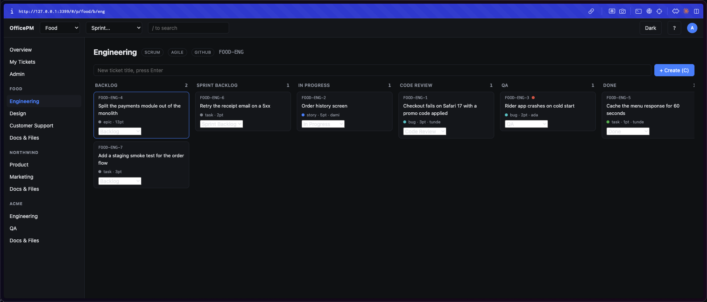
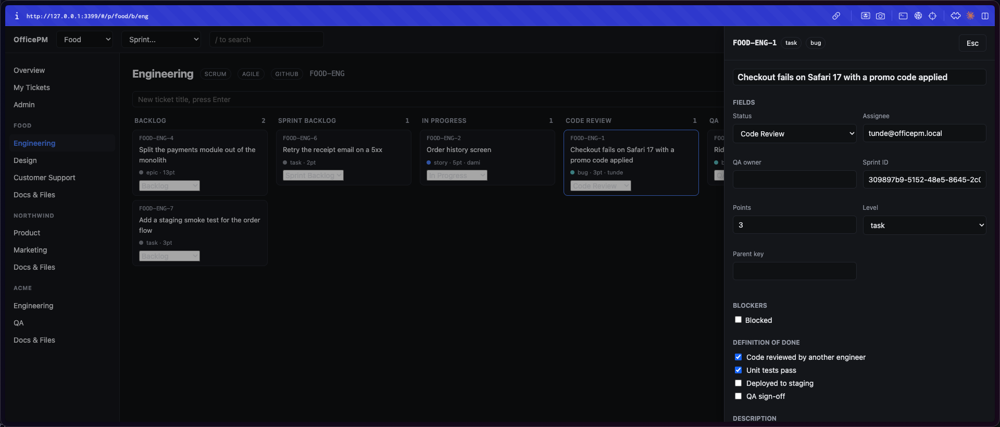
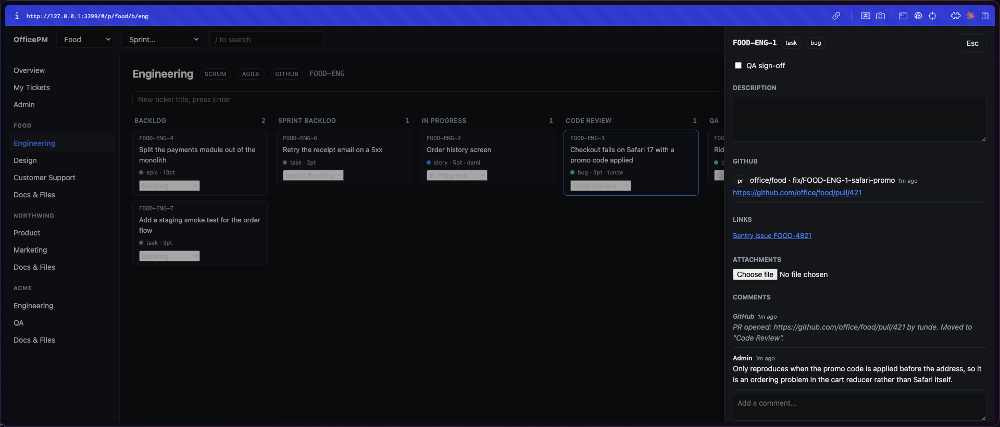
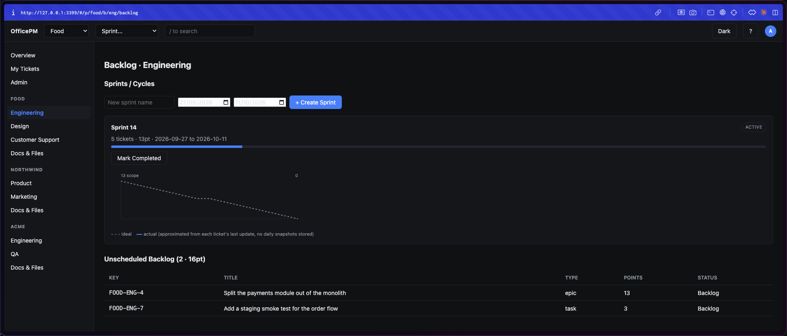

# OfficePM

Self-hosted project management for a small office. **One Node process, one SQLite
file, five runtime dependencies, and no build step.** Open `index.html` in the
repo and you are looking at the whole frontend.

It runs five workflow methodologies (Kanban, Scrum, Scrumban, Shape Up,
Waterfall), an opt-in agile layer on any of them, and GitHub webhooks that move
tickets on PR open, deploy and release, so engineering status updates itself.



## The constraint

The interesting part of this project is what is not in it.

| | |
|---|---|
| Runtime dependencies | 5 (`express`, `better-sqlite3`, `cookie-parser`, `multer`, `bcrypt`) |
| Build step | none, the browser loads the ES module directly |
| Frontend framework | Preact + htm, 3 KB, vendored as one local file |
| Bundler, transpiler, CSS framework | none |
| Database | one SQLite file, `better-sqlite3`, synchronous |
| Cloud services | none, it runs on a machine in the office |
| Total application code | about 2,900 lines across four files |
| Tests | 93, on `node --test`, no test framework dependency |

Nothing is shipped to the browser except this application's own code. The
backend is one file you can read start to finish in under an hour. That is the
point: a tool a small team relies on should be one a single person can still
hold in their head two years later.

## What it does

**Projects and boards.** Multiple projects, each with its own boards, each board
with its own workflow. Boards are declared in `projects.json`, not in the
database, so changing the team's process is a text edit and a restart.

**Five flows.** A board picks Kanban, Scrum, Scrumban, Shape Up or Waterfall and
the UI adapts. Waterfall boards refuse to skip a phase. Scrum and Scrumban get
sprints, burndown and velocity. Shape Up gets 6-week cycles and 2-week
cooldowns.

**An agile layer, opt in per board.** Epics and stories, acceptance criteria,
Definition of Done and Definition of Ready, retros created automatically when a
sprint completes, a standup view, and blockers. A team that does not want any of
it is not shown any of it.



**GitHub integration.** Three webhook endpoints for GitHub Actions. A PR opening
moves its ticket to Code Review and posts a comment, a deploy moves it to QA or
Done depending on environment, and a release moves everything named in the
changelog. Ticket keys are read out of branch names and commit messages. Boards
without `has_github` are never touched by CI.



**Sprints, burndown, velocity.**



**Docs, links and file uploads** scoped to a project or a ticket, with real
limits (25 MB per file, 20 per ticket, 100 per project), an extension blocklist,
uuid filenames on disk, and downloads that always serve as an attachment and
always require a session.

**Real-time.** Server-Sent Events, so a ticket someone else moves appears
immediately without polling.

**Keyboard first.** `Cmd+K` command palette, `/` to search, `J` and `K` to move
through tickets, `Enter` to open, `E` to edit, `A` to assign to yourself, `G`
then `B`, `S` or `R` to jump. `?` lists them all.

## Running it

Node 20 or newer.

```bash
npm install
cp .env.example .env
# edit .env and set PM_TOKEN to a long random string
node --env-file=.env server.js
```

Open `http://localhost:3000`. On the first boot against an empty database the
server creates an admin user and either uses `ADMIN_PASSWORD` from `.env` or
prints a generated one to the terminal once. Copy it down immediately.

Projects and boards come from `projects.json`. The server validates it on
startup and refuses to boot on malformed JSON, a duplicate board prefix, an
unknown flow or a project with no boards, telling you which one and why. A
half-configured server is worse than one that will not start.

Optional environment variables: `PM_DATA_DIR` puts `pm.db` and `uploads/` on a
separate volume, `PM_PROJECTS_FILE` points at a config elsewhere. Both default
to the code directory.

## Tests

```bash
npm test
```

93 tests on Node's built-in test runner. They boot a real server in a child
process against a throwaway data directory and talk to it over HTTP, because the
parts most worth testing here (session cookies, multipart uploads,
`Content-Disposition`, webhook tokens) only exist at that boundary.

The security tests are regression tests for bugs this codebase actually had, and
each one was verified by reverting its fix and confirming the test fails. Among
them: session expiry compared as a raw string against SQLite's datetime format,
which accepted an expired session whenever the date part happened to match; a
password reset that left the user's existing sessions alive; and an extension
blocklist that `evil.exe.` walked straight through, because `path.extname`
returns `'.'` for a name with a trailing dot.

## How it is put together

| Path | What |
|---|---|
| `server.js` | All backend logic: auth, API, SQLite schema, GitHub webhooks, SSE |
| `index.html`, `app.js`, `styles.css` | The entire frontend |
| `vendor/htm-preact.module.js` | Vendored Preact + htm runtime |
| `projects.json` | Project and board definitions, the source of truth, not the database |
| `test/` | 93 tests |
| `PRD.md` | The specification this was built against |
| `ROLLOUT.md` | Hosting, Tailscale, GitHub Actions, backups, and a user guide |

`PRD.md` is the actual product specification, including its explicit out-of-scope
list. The code was built against it section by section, and the one deliberate
deviation from it (`multer` 2.4.0 against a pinned `1.4.5-lts.1`) is recorded in
the git history with the reason.

## Deploying it

`ROLLOUT.md` covers running it under systemd on an office machine, reaching it
remotely over Tailscale with nothing exposed to the public internet, wiring up
GitHub Actions safely, nightly backups, and a plain-language guide for everyone
else in the office.

Backups are one command:

```bash
tar czf pm-backup-$(date +%F).tar.gz pm.db projects.json uploads/
```

## What this deliberately is not

No custom field builder, no workflow automation builder, no Gantt charts, no
multi-tenant SaaS, no mobile app, no SSO, no email or Slack notifications, no
rich text editor, no per-project permissions. v1 is for a small office where
everyone logged in can see every project, on purpose.

`PRD.md` section 16 has the full list. The rule there still applies: add these
only when a real team complains about a real problem, not before.
