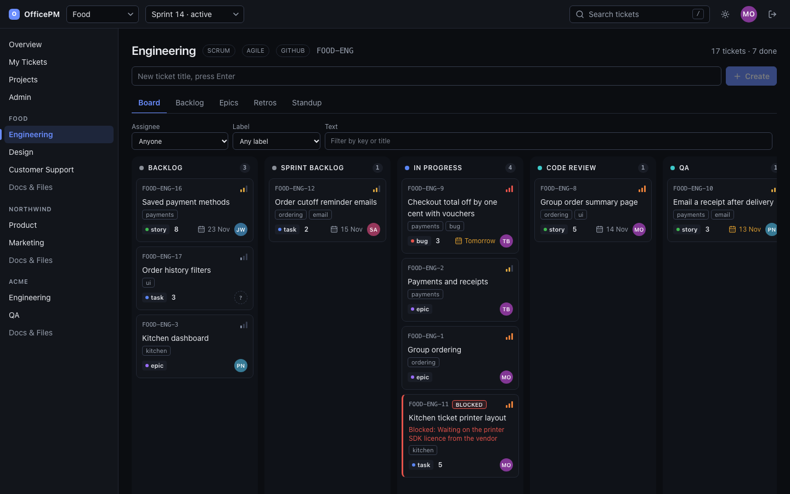
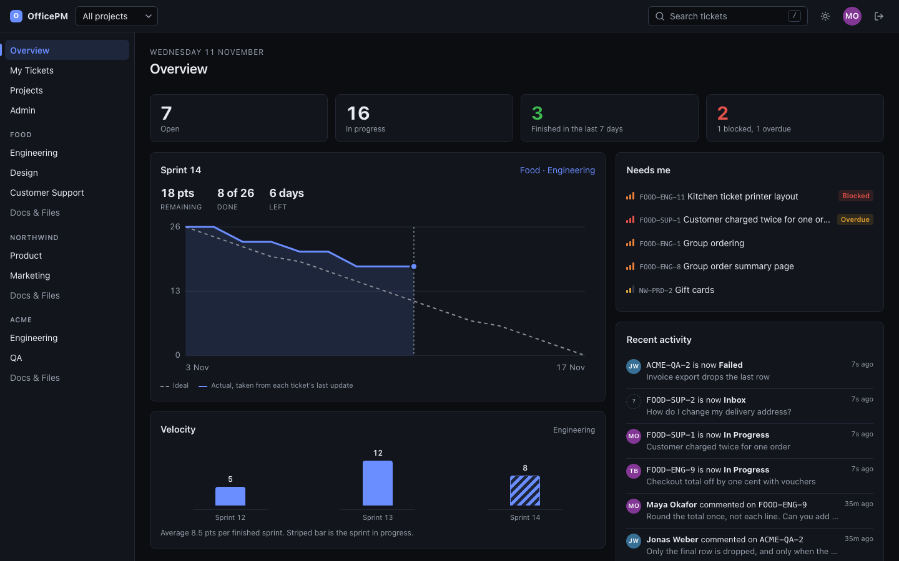
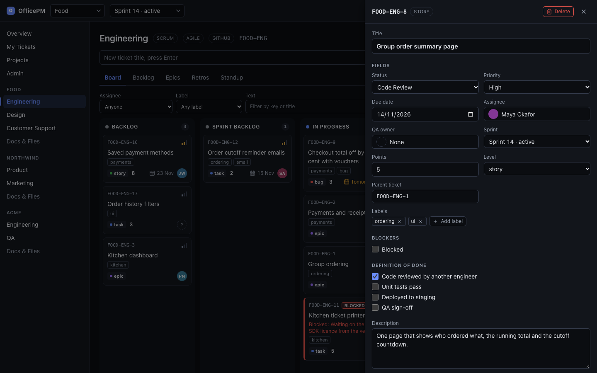
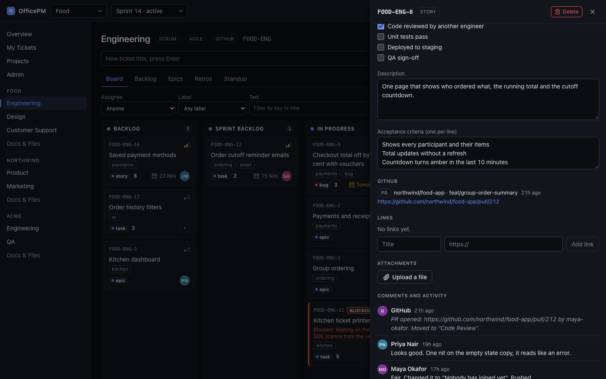
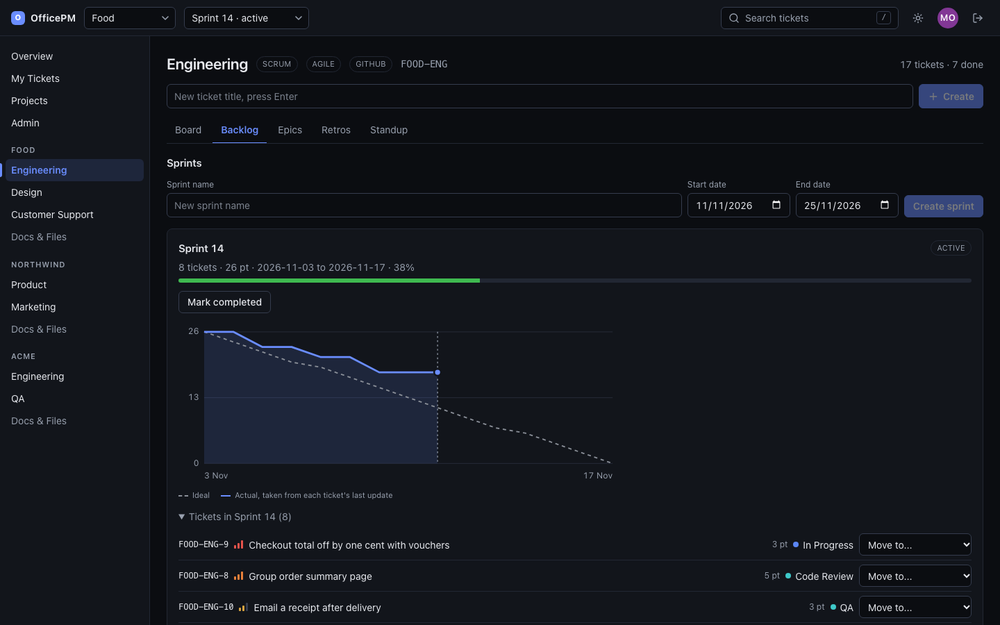
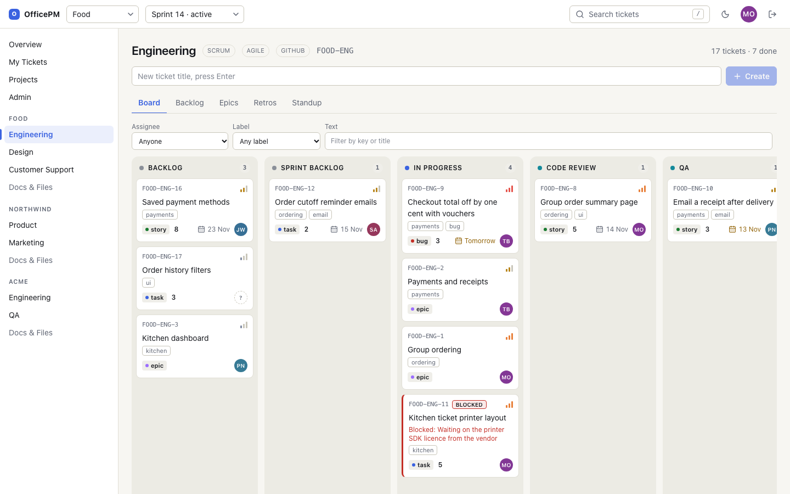
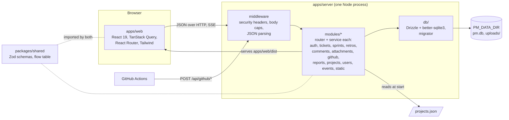

# OfficePM

Self-hosted project management for a small office. One server process, one SQLite
file, and a React client the server hands out itself. No cloud services, no
accounts with anyone, nothing to pay for.

It runs five workflow methodologies (Kanban, Scrum, Scrumban, Shape Up,
Waterfall), an opt-in agile layer on any of them, and GitHub webhooks that move
tickets on PR open, deploy and release, so engineering status updates itself.



> **This is v2**, a TypeScript rewrite: `apps/server` (Hono, Drizzle, SQLite),
> `apps/web` (React), `packages/shared` (the Zod contract both sides import). The
> original v1 is no longer in the tree (it lives in git history, last at commit `5b25841`),
> and v2 opens a v1 `pm.db` as it is. Status of the rewrite and what is left before it
> replaces v1 is in [docs/ARCHITECTURE-PLAN.md](docs/ARCHITECTURE-PLAN.md).

## Quick start

You need Node 22 or newer and pnpm 10 (`corepack enable` picks the version from
`package.json`, or `npm install -g pnpm@10`). The native modules (`better-sqlite3`,
`bcrypt`) come as prebuilt binaries where one exists and compile otherwise, which
needs Python, make and a C++ compiler.

### From source, with the demo workspace

```bash
pnpm install
pnpm seed          # demo data into .data/ (about 62 tickets, 6 users, 7 boards)
pnpm dev           # builds, then serves the app on http://localhost:3000
# sign in as maya.okafor@officepm.demo / demo-password
```

`pnpm dev` and `pnpm seed` use `.data/` in the repository, never a `pm.db` sitting
in the repo root. The demo password is public, so only seed a machine you do not
expose. If port 3000 is taken, set `PORT` to a free one (`PORT=3001 pnpm dev`); the
server prints one line and exits when the port is in use. For live reload of the client,
leave `pnpm dev` running and start `pnpm dev:web` in a second terminal: Vite serves the
client on http://localhost:5173 and proxies `/api` to port 3000.

Without the seed, the first start creates an admin account instead. Set
`ADMIN_EMAIL` and `ADMIN_PASSWORD` first, or the server prints a generated password
once, which you must copy down.

### From source, for real use

```bash
pnpm install && pnpm build
cp .env.example .env     # set PM_TOKEN, ADMIN_PASSWORD, and PM_DATA_DIR to a directory of its own
PM_DATA_DIR=/var/lib/officepm ADMIN_PASSWORD=choose-one PM_TOKEN=a-long-random-string pnpm start
```

`pnpm build` compiles the server and bundles the client; `pnpm start` serves the
bundle from `apps/web/dist`. Leaving `PM_DATA_DIR` unset puts `pm.db` in the
repository root, where v1 kept it. Set it. `ROLLOUT.md` has the systemd unit.

### With Docker

```bash
cp .env.example .env     # set PM_TOKEN and ADMIN_PASSWORD
docker compose up -d --build
curl http://127.0.0.1:3000/api/health      # {"ok":true}
```

The image is a multi-stage build on `node:24-bookworm-slim` (pinned by digest),
runs as the unprivileged `node` user with a read-only root filesystem, and has a
healthcheck. `pm.db` and `uploads/` live in the volume `officepm-data`, so
rebuilding never touches them. The port is published on `127.0.0.1` only; see the
config table to change that. To load the demo workspace into a fresh volume, run
this before the first `up`:

```bash
docker compose run --rm officepm node apps/server/dist/seed-main.js
```

Seeding creates the demo users, so the first-boot admin is then not created. Sign
in as Maya, who is an admin.

## What it does

**Boards you can drag.** Move a ticket by dragging it to another column, with the
card jumping at once and snapping back with the reason if the board refuses the
move. From the keyboard, focus a card, press Space, choose a column with Left and
Right, press Space again. On a phone a long press picks the card up. Cards show
assignee, priority, labels, points and due date.



**Projects and boards.** Multiple projects, each with its own boards, each board
with its own workflow. Boards are declared in `projects.json`, not in the
database, so changing the team's process is a text edit and a restart. The sidebar
follows where you are: inside a project it shows only that project (its boards and
Docs & Files) with an All projects link back, and on Overview, My Tickets, Projects
and Admin it lists every project grouped.

**Five flows.** A board picks Kanban, Scrum, Scrumban, Shape Up or Waterfall and
the UI adapts. Waterfall boards refuse to skip a phase. Scrum and Scrumban get
sprints, burndown and velocity. Shape Up gets 6-week cycles and 2-week cooldowns.

**An agile layer, opt in per board.** Epics and stories, acceptance criteria,
Definition of Done and Definition of Ready, retros created automatically when a
sprint completes, a standup view, and blockers. A team that does not want any of it
is not shown any of it.



**GitHub integration.** Three webhook endpoints for GitHub Actions. A PR opening
moves its ticket to Code Review and posts a comment, a deploy moves it to QA or
Done depending on environment, and a release moves everything named in the
changelog. Ticket keys are read out of branch names and commit messages. Boards
without `has_github` are never touched by CI. On a Waterfall board a webhook obeys
the same no-skipping rule as a person.

Webhooks authenticate with a shared token, not a signature. Set `PM_TOKEN` on the
server and send the same value in an `x-pm-token` header from your workflow (`curl -H
"x-pm-token: $PM_TOKEN"`, see `ROLLOUT.md`). There is no HMAC and no
`X-Hub-Signature-256` check, so they are meant to be called from your own GitHub Actions,
not pointed at by GitHub's webhook settings page. With `PM_TOKEN` empty the endpoints
answer 500, and a wrong or missing header is a 401.



**Sprints, burndown, velocity.**



**Docs, links and file uploads** scoped to a project or a ticket, with limits (25 MB
per file, 20 per ticket, 100 per project), an extension blocklist, uuid filenames on
disk, and downloads that always serve as an attachment and always require a session.

**Handoffs.** Moving a ticket to another status (a drag, the Alt+arrow keys, or the
status field in the ticket) opens a dialog instead of moving it at once. It shows the
ticket, where it is and where it goes next (any later status the workflow allows), and
asks for a decision: Approve moves it forward, Reject sends it back to the previous or a
chosen earlier stage and needs a reason. The same dialog hands the ticket on: pick a
person and or a department, add a note and attach screenshots or files (drop, paste or
choose; the normal upload limits and blocklist apply). Confirming moves the ticket
under the board's usual rules (a Waterfall board still refuses to skip a phase), sets
the assignee, and posts the note as a comment marked Handoff. Cancel, or Esc, leaves
the card where it was. The recipient is told: a count on My Tickets in the sidebar and
top bar, a Handed to you list on My Tickets (including handoffs to their department),
pushed live over the event stream. Departments are an optional label an admin sets per
person on the Admin page; they filter the handoff's people picker.

**More people on a ticket.** A ticket keeps one assignee. Anyone else who works on it is
listed under People in the ticket drawer, each with an optional short role (PM, Frontend,
Backend: one plain line, 30 characters at most). Their initials show on the board card
(three, then +N). The handoff dialog has an Also involve list: the person under Hand over
to stays the single assignee, everyone ticked there is added to People and told about the
handoff too, so each sees it under Handed to you and in the unread count. Tickets where
you are listed but are not the assignee appear on My Tickets under Also on; the assigned
list is unchanged. Anyone signed in can add or remove people, as anyone signed in can edit
a ticket today: v1 has no per-ticket permissions and this adds none.

**Sub-tickets.** The hierarchy is epic, ticket, sub-ticket, and a sub-ticket is one level
deep: a sub-ticket cannot have its own sub-tickets, an epic cannot be a sub-ticket or hold
them (an epic holds tickets, through the drawer's Epic field), a ticket cannot be its
own parent, and parent and child are in one project. In the ticket drawer, a Sub-tickets
section adds one when you type a title and press Enter (an epic or a sub-ticket shows a short
explanation instead of the box), lists each with its key, status and
assignee, and opens it on a click; a sub-ticket's drawer has a "sub of KEY" button back to its
parent. A sub-ticket is an ordinary ticket in every other way: its own key from the board's
numbering, the board's statuses and workflow rules, its own assignee, people and handoffs. On
the board the parent card shows done over total (3/5), and a sub-ticket card is dashed and says
"sub of KEY". The board header counts top-level tickets and says how many sub-tickets there are
on top of them, so the same work is not counted twice. Approving a parent into a done status
while sub-tickets are open shows how many, and needs Close anyway to be ticked: a warning, not
a block. Deleting a parent keeps its sub-tickets as ordinary tickets, as deleting an epic does
for its children.

**Feature pipelines.** A feature is an epic that travels through your project's phases, and
each team's work on it is its own ticket. An admin sets a project's phases on the Admin page
(add, rename, reorder, remove, and a department for each); until then a project uses Product,
Design, Engineering, QA, Release. A new epic on a project with phases starts at the first one
(any other epic starts a pipeline from its drawer). The handoff dialog on a feature moves it
between phases: Approve goes to the next phase or any later one, Reject goes back and needs a
reason, so Design and Product can pass it back and forth, and the dialog suggests the next
phase's department for the hand-over. Under the feature, a Backend ticket and a Frontend ticket
are separate tickets, each with its own assignee and status, tagged with a phase and a team lane.
The Epics screen shows each feature as a stepper (every phase, the current one marked, done of
total per phase), the tickets grouped by phase and lane, and a form that adds a ticket with its
phase and lane preselected. Moving a feature out of a phase while tickets tagged with it are open
warns and needs Move anyway (the server asks for the same). Approving out of the last phase
completes the feature. The epic's drawer lists every move: who, from and to, why. Epics that
never start a pipeline look and work as before.

**Real-time.** Server-Sent Events, so a ticket someone else moves appears
immediately without polling.

**Keyboard first.** `Ctrl/Cmd+K` command palette, `/` to search, `J` and `K` to
move through tickets, `Enter` to open, `E` to edit, `A` to assign to yourself, `G`
then `B`, `S` or `R` to jump, `C` to create. `?` lists them all. Light and dark
themes, and a layout that works on a phone.



## How it is put together



The server is a Hono app. Each feature is a folder under
`apps/server/src/modules/` holding a router (parse the request, call the service,
shape the response) and a service (the rules, and the SQL). The database is the one
v1 created: the migrator in `apps/server/src/db/` applies additive migrations and
records them in a table of its own, so a v1 `pm.db` opens unchanged. The client
validates every response against the same Zod schemas the server tests use, so a
handler that drifts from the contract fails a test rather than a screen.

### Creating a ticket

`POST /api/tickets` needs a signed-in session: `POST /api/login` with `{ email, password }`
sets a `pm_session` cookie, and the other calls send it back. The body is JSON and the
reply is 201 with the ticket. A bad field is a 400 with `{ "error": "..." }`.

```bash
curl -c jar -H 'Content-Type: application/json' \
  -d '{"email":"maya.okafor@officepm.demo","password":"demo-password"}' \
  http://localhost:3000/api/login
curl -b jar -H 'Content-Type: application/json' \
  -d '{"project_slug":"food","board_slug":"eng","title":"Fix the checkout total","type":"bug"}' \
  http://localhost:3000/api/tickets
```

| Field | Required | What |
|---|---|---|
| `project_slug`, `board_slug` | yes | Where the ticket goes, as named in `projects.json`. 400 for an unknown pair |
| `title` | yes | 1 to 200 characters. Longer is a 400 |
| `type` | yes | One of the board's `types` in `projects.json` (for example `epic`, `story`, `task`, `bug`) |
| `status` | no | One of the board's `statuses`. Anything else, or nothing, starts in the first status |
| `assignee`, `qa_owner` | no | A user's email |
| `description` | no | Text |
| `priority` | no | `urgent`, `high`, `medium` or `low` |
| `labels` | no | Up to 8 strings, each 1 to 24 characters |
| `due_date` | no | `YYYY-MM-DD`, a real date |
| `sprint_id` | no | A sprint id |
| `parent_key` | no | The key of the parent epic |
| `blocker_reason` | no | Text |
| `phase`, `department` | no | Pipeline tags for a ticket under an epic; see the pipeline notes below |
| `level`, `acceptance_criteria` (array of strings), `blocked` (boolean) | no | Kept only on boards with `agile: true`; `level` defaults to `task` there |
| `points` (integer) | no | Kept only on boards with `points: true` |
| `appetite` | no | Kept only on Shape Up boards |

The request schema is `TicketCreateRequestSchema` in `packages/shared/src/requests.ts`.
`PATCH /api/tickets/:key` takes the same fields except the two slugs, any subset, with the
same 200 character title limit. `GET /api/session` is what the web client asks on load:
the signed-in user, or `null` with a 200 when nobody is signed in, so a first visit does not
print a 401 in the browser console. `GET /api/me` is unchanged and still answers 401.

### API additions since v1

All additive: v1's routes and response shapes are unchanged, and a v1 server still runs
on the migrated database (migration `0001-handoffs`: one nullable column and two tables; `0002-participants`: two more tables; `0003-subtickets`: one nullable column on `tickets`; `0004-pipeline`: the `project_phases` table, `phase` and `department` on `tickets` and `kind` on `ticket_handoffs`).

| Route | Who | What |
|---|---|---|
| `POST /api/tickets/:key/handoff` | signed in (as for `PATCH /api/tickets/:key`) | `{ decision: "approve" or "reject", to_status?, from_status?, reason?, assignee_id?, department?, note?, attachment_ids? }`. Moves the ticket, sets the assignee, posts a comment with `source: "handoff"` and records the handoff, in one transaction. `reason` is required to reject. `to_status` defaults to the next (approve) or previous (reject) status. `from_status` makes it fail with 409 if the ticket moved meanwhile. Returns `{ ticket, comment, handoff }` |
| `GET /api/handoffs/unread` | signed in | Handoffs addressed to you (by email, or by department when no person was named) that you have not read |
| `POST /api/tickets/:key/handoffs/read` | signed in | Marks the handoffs on a ticket read for you |
| `GET /api/people` | signed in | `[{ id, name, department }]` for the handoff pickers: an opaque user id (what `assignee_id` takes), the name and the department, and no email. `GET /api/users`, which has emails, stays admin-only. A handoff still returns the chosen assignee's email on the ticket, as every ticket shows its assignee email, so the list hides emails but a handoff reveals one |
| `PATCH /api/users/:id/department` | admin | `{ department: string or null }`, up to 40 characters on one line |
| `POST /api/users` | admin | now also accepts an optional `department` |
| `GET /api/tickets/:key/participants` | signed in | `[{ id, name, department, role }]`, oldest first. Never an email |
| `POST /api/tickets/:key/participants` | signed in | `{ user_id, role? }`. `role` is one plain line, 1 to 30 characters after trimming, or null for none. 201 when added, 200 when the person was already on the ticket and only the role changed. 400 for an unknown user or a bad role, 409 for the ticket's own assignee. Returns the one participant |
| `DELETE /api/tickets/:key/participants/:userId` | signed in | Removes that person from this ticket only; 404 if they are not on it |
| `GET /api/my-tickets/participating` | signed in | Tickets you are a participant on and not the assignee of. `GET /api/my-tickets` is unchanged |

`GET /api/tickets` and `GET /api/tickets/:key` add a `participants` array to each ticket
(`PATCH`, `POST` and the event stream do not carry it). `POST /api/tickets/:key/handoff`
also takes `participant_ids` (up to 20 user ids): they become participants, keep any role they
already had, and get the unread nudge. The event stream gains `ticket.participants.changed`,
which carries only the ticket key.

| `POST /api/tickets/:key/subtickets` | signed in | `{ title, type?, assignee? }`. Creates a ticket on the parent's board with `subticket_of` set to `:key`. `type` defaults to `task` (else the first type that is not `epic`). 201 with the ticket. 400 for a missing title, an unknown type or `epic`; 404 for an unknown parent; 409 when the parent is an epic or is itself a sub-ticket |
| `PUT /api/tickets/:key/subticket-of` | signed in | `{ parent_key: string or null }`. Makes an existing ticket a sub-ticket of another, or null to make it an ordinary ticket again. 409 for: own parent, an epic on either side, a third level (the parent is a sub-ticket, or the ticket already has sub-tickets), or a parent in another project. Parent and child may be on different boards of one project. The web client does not use this route yet |

`GET /api/tickets/:key` adds `subtickets` (`[{ key, title, status, type, assignee_name }]`, oldest
first, and `assignee_name` is a name or null, never an email) and `progress` (`{ done, total }`, done
meaning the sub-ticket's status is in its board's `done_statuses`). `GET /api/tickets` adds `progress`
to each ticket. Every ticket the server returns has `subticket_of` (a key or null). `POST
/api/tickets/:key/handoff` also takes `close_anyway: true`, which a move of a parent into a done
status needs while it has open sub-tickets (otherwise 409 with the count). `PATCH /api/tickets/:key`
and the GitHub webhooks are unchanged, so they can still move a parent to Done with open sub-tickets;
the one new refusal is `PATCH` of `type` to `epic` on a ticket that is, or has, sub-tickets (409).

| `GET /api/projects/:slug/pipeline` | signed in | `{ configured, phases: [{ name, department }] }`. `configured` is false while the list is the built-in default (Product, Design, Engineering, QA, Release) and nothing is stored. 404 for an unknown project |
| `PUT /api/projects/:slug/pipeline` | admin | `{ phases: [{ name, department?, was? }] }`, 1 to 12 phases in order, replacing the list. Names are one line, 40 characters at most, different ignoring case; `department` is validated like a user's. `was` names the phase an entry used to be called, so a rename keeps its tickets. 400 for a bad list, 409 when a removed phase is still used by tickets (the message says how many) |
| `GET /api/tickets/:key/pipeline` | signed in | For an epic: `{ in_use, current, completed, phases: [{ name, department, done, total }], history: [{ id, decision, from_phase, to_phase, completed, reason, note, from_name, to_names, to_department, created_at }] }`. `done` and `total` count the tickets under the epic tagged with each phase. Names only, never an email. 409 for a ticket that is not an epic |
| `POST /api/tickets/:key/pipeline/start` | signed in | Starts an epic at its project's first phase. 409 if it already has a phase or is not an epic |

`POST /api/tickets/:key/handoff` on an epic that is on a pipeline takes `to_phase`, `from_phase` and
`move_anyway` where a ticket takes `to_status`, `from_status` and `close_anyway`; the decision, reason,
assignee, department, note, attachments and `participant_ids` work as before. Approve moves to the next
phase or any later one, and from the last phase completes the feature (the epic takes its board's first done
status); reject moves to an earlier phase and needs a `reason`. Approving out of a phase while tickets tagged
with it are not done is a 409 with the count unless `move_anyway: true`. The result gains
`phase: { from, to, completed }` (`to` is null on completion). `POST /api/tickets` and `PATCH
/api/tickets/:key` accept `phase` and `department` on a ticket (`phase` must be in the project's list;
`PATCH` of `phase` on an epic is a 409, it moves by handoff). Every ticket the server returns has
`phase` and `department` (a string or null). The event stream gains `pipeline.changed` (the project slug).
No new response carries an email; a handoff that names an assignee still returns that email on the ticket.

What this does not hide: the ticket's `assignee` is still an email on every ticket, as in v1,
and a handoff that names an assignee still returns that email. The participants lists, the
`participant_ids` handoff path and the new event add no email. Participants are visible to every
signed-in user, like the assignee.

`GET /api/users` rows gain `department`, comments may have `source: "handoff"`, and the
event stream gains `handoff.created` (user ids and the ticket key, never emails, the note or the reason).

### Project layout

| Path | What |
|---|---|
| `apps/server/src/` | The server: `app.ts` (middleware and routes), `main.ts` (entry), `config.ts`, `projects-config.ts`, `bootstrap.ts`, `backup.ts`, `seed-main.ts` |
| `apps/server/src/modules/<name>/` | One feature each: `routes.ts` and `service.ts` |
| `apps/server/src/http/` | Cross-cutting HTTP code: auth guard, body and size limits, login throttle, security headers, validation |
| `apps/server/src/db/` | Drizzle schema, migrations, migrator, upload path resolver |
| `apps/server/src/seed/` | The demo workspace (`demo-data.ts`) and the code that writes it |
| `apps/web/src/` | The client, one folder per product area under `features/`; see `apps/web/README.md` |
| `apps/web/e2e/` | Playwright specs, one per view, plus axe and the security headers |
| `packages/shared/src/` | The contract: entity, request and response schemas, and the flow capability table |
| `tests/conformance/` | The 104 HTTP-level tests, run against the compiled v2 server |
| `tests/data-compat/` | Proof that v2 opens v1 databases and that v1 still runs on them afterwards; `frozen-v1/` holds the three v1 files it needs |
| `projects.json` | Project and board definitions, the source of truth, not the database |
| `Dockerfile`, `docker-compose.yml` | The container image and a one-machine deployment |
| `PRD.md` | The specification v1 was built against |
| `ROLLOUT.md` | Hosting, Tailscale, GitHub Actions, backups, upgrades, and a user guide |

## Public demo

OfficePM can run as a public demo that anyone can try without installing anything.
Set `DEMO_MODE=true` (see [Configuration](#configuration)) and the server comes up with the
demo workspace already seeded, shows a banner that says so, and turns off what a stranger
should not be able to do.

[](https://render.com/deploy?repo=https://github.com/Abydin/officepm)

The button deploys [`render.yaml`](render.yaml) to Render's free plan, and it only works once
that file is on `main`. To try the demo mode on your own machine instead:
`pnpm build && DEMO_MODE=true PM_DATA_DIR=$(mktemp -d) pnpm start`.

- **Sign in** as `maya.okafor@officepm.demo` with the password `demo-password`. Both are
  public by design, and so is everything you add: the data is shared by every visitor.
- **Nightly reset.** At 03:00 UTC the whole workspace is wiped and reseeded in place, in one
  transaction (a reseed that fails leaves the previous data), and every signed-in session ends.
  Anything a visitor changed is gone by morning.
- **It will not touch a real database.** At start, and again before every reset, the demo checks
  that the database holds only demo data: any user whose email does not end in `@officepm.demo`,
  or tickets with no demo user, and it refuses to start (or skips that night's reset) with an
  error. It never deletes anything in that case. Still point it at a directory of its own.
- **One minute to wake up.** On Render's free plan the service sleeps after 15 minutes without
  traffic, and the first visit after that waits about a minute for it to start. Every cold start
  on an ephemeral disk seeds fresh data. A restart in the same container keeps whatever is in
  the database until the next 03:00 reset.
- **What is turned off,** each answered with a `403` and a message starting `demo_mode`: file
  uploads, creating users, password and department changes, ticket links and project docs
  (they would put a stranger's URL in front of the next visitor), and the GitHub webhooks.
  Failed logins are throttled harder than usual, writes are capped per address (60 a minute) and
  overall (120 a minute), sign-ins have a tighter budget of their own (10 a minute per address),
  a JSON body may be at most 64 KB, the database file may not grow past 25 MB, and at most 200
  event streams (5 per session) are open at once.
- **Visitor counting is off.** Nothing is loaded from another site unless `GOATCOUNTER_CODE` is
  set to a [GoatCounter](https://www.goatcounter.com/) site code. Then, and only then, one
  counting script is added to the page and the Content-Security-Policy allows its two hosts.

- **Known thing to verify on the first deploy: the client address behind Render.** The per-address
  limits assume Render's proxy puts the visitor's address last in `X-Forwarded-For` (hence
  `PM_TRUST_PROXY=1` in `render.yaml`). This could not be checked off Render, so the demo logs, at
  startup and for its first five write requests only, whether trust is on, how many
  `X-Forwarded-For` entries arrived, and whether the resolved address looks private (a proxy's own
  address). No addresses are logged. Expect `entries` of 1 or more and `looks private=false` for a
  visitor on the public internet. `entries=0`, `unknown` or `looks private=true` means every
  visitor is being counted as one client: fix that before sharing the link.

Never put real data on a demo: it is public, shared and wiped.

## Configuration

All configuration is environment variables.

| Variable | Default | What |
|---|---|---|
| `PORT` | `3000` | Port the server listens on (inside the container too; the compose file maps it) |
| `PM_DATA_DIR` | repository root (image: `/data`) | Directory holding `pm.db` and `uploads/`. Set it to a directory of its own. |
| `PM_PROJECTS_FILE` | `projects.json` in the repository root | Project and board definitions. The server refuses to start if it is malformed. |
| `PM_WEB_DIR` | `apps/web/dist` (image: `/app/apps/web/dist`) | Directory the built client is served from |
| `PM_TOKEN` | empty | Shared secret for the GitHub webhooks (`x-pm-token` header). Empty disables them. |
| `ADMIN_EMAIL` | `admin@officepm.local` | First-boot admin, used only while the users table is empty |
| `ADMIN_PASSWORD` | generated, printed once | Password for that admin |
| `PM_TRUST_PROXY` | off | `1` or `true` behind a reverse proxy, so the login throttle uses the address in `X-Forwarded-For`. Leave off when reached directly: a client could forge it. |
| `DEMO_MODE` | off | `true`, `1` or `yes` (any case) runs the public demo (see [Public demo](#public-demo)): seeds the demo workspace when the database is empty, creates no first-boot admin, refuses uploads and account changes, throttles harder, and resets every night at 03:00 UTC. Needs `PM_DATA_DIR`, so it can never wipe a database in the repository root, and refuses a database that holds anything but demo data. Set to anything it does not recognise (other than `false`, `0`, `no`, `off` or empty), the server refuses to start instead of running as a normal instance. |
| `GOATCOUNTER_CODE` | empty | A GoatCounter site code (letters, digits and hyphens). Set, the page gets the counting script and the Content-Security-Policy allows `gc.zgo.at` and `<code>.goatcounter.com`. Unset, nothing external is loaded. Anything else makes the server refuse to start. |
| `NODE_ENV` | `development` | Only printed at startup |
| `PM_HOST_BIND`, `PM_HOST_PORT` | `127.0.0.1`, `3000` | docker compose only: where the container is published on the host |

`pnpm start` loads no `.env` file. Put variables in the shell, or run
`node --env-file=.env apps/server/dist/main.js`.
docker compose reads `.env` itself.

## Commands

| Command | What |
|---|---|
| `pnpm build` | Compile the server and bundle the client |
| `pnpm start` | Run the server (`PM_DATA_DIR` as given) |
| `pnpm dev` | Build, then run against `.data/` |
| `pnpm dev:web` | Vite dev server for the client on :5173 |
| `pnpm seed` | Demo workspace into `$PM_DATA_DIR` (default `.data/`) |
| `pnpm backup [dir]` | Consistent snapshot of the data directory, safe while the server runs |
| `pnpm lint`, `pnpm format:check`, `pnpm typecheck` | Static checks |
| `pnpm test` | Conformance, unit, data-compat |
| `pnpm test:conformance` | The 104 conformance tests against the v2 server (builds it first) |
| `pnpm test:e2e` | Browser suite (needs `pnpm --filter @officepm/web exec playwright install chromium` once) |

## Tests

Four layers, each aimed at a different failure.

- **Conformance, the contract.** `tests/conformance/` holds 104 tests on Node's
  built-in runner. They boot a real server in a child process against a throwaway
  data directory and talk to it over HTTP, because what is worth testing (session
  cookies, multipart uploads, `Content-Disposition`, webhook tokens) only exists at
  that boundary. They were written against v1 and defined its behaviour; since the
  cutover they run against the compiled v2 server and the v2 seeder by default
  (`pnpm test:conformance` builds the server first), and all 104 must pass. The server
  under test can be changed with `OFFICEPM_SERVER_CMD` and the seed script with
  `OFFICEPM_SEED_CMD`. CI fails if the count is anything else, or if any test fails.
  These tests are the contract and are never weakened to make a change pass.
- **Unit** (`pnpm test:unit`, Vitest). The server in-process with every response checked
  against the shared Zod schemas, the hardening rules, the backup and the seeder
  (which is also compared row for row with v1's seed script, kept in `tests/data-compat/frozen-v1/`), the shared package, and the
  web client's components.
- **Data compatibility** (`pnpm test:data-compat`). Builds databases with v1's own
  code, kept verbatim in `tests/data-compat/frozen-v1/` (empty, seeded, an old column shape,
  uploads moved to another directory),
  opens them with v2, and checks that no row changed, that v1 still boots and logs
  in on the result, and that stored upload paths resolve.
- **End to end** (`pnpm test:e2e`). A real browser against a seeded v2 server:
  every screen's flows, the security headers, and axe over each view in both
  themes with zero violations.

Several security tests are regression tests for bugs this codebase actually had,
and each was verified by reverting its fix and confirming the test fails.

## Security notes

OfficePM is built for a trusted network such as an office LAN or a Tailscale
tailnet. It is not hardened for the public internet; do not port-forward it.

- Passwords are bcrypt (10 rounds). Sessions are random ids stored in SQLite and
  last 7 days, in an `HttpOnly`, `SameSite=Lax` cookie that is `Secure` when the
  proxy reports `X-Forwarded-Proto: https`. There is no self-signup; an admin
  creates every account. Resetting a password closes that user's event streams.
- There is no separate CSRF token: writes rely on the `SameSite=Lax` cookie.
- Failed logins are throttled in a 15 minute window, answered 429 before any password
  work: per full client address (30; an IPv6 address by all its groups, link-local with
  its zone id), per IPv6 /64 (150, so two addresses of one subscriber do not share the
  strict budget but a client rotating through a /64 is still capped), per address and
  email pair (8) and per email overall (100). Attempts are counted before the password
  check finishes, so parallel guesses cannot beat the limit. Because the email limit is
  per pair, one client cannot lock an account out for everyone else. Past 100 failures
  on an email, a client that has already failed on it is held, and a new address is let
  through at one per 2 seconds. An email with no account counts against the address
  only, and an unknown email costs one decoy compare, so timing does not reveal which
  accounts exist. The state is in memory (four maps of 10,000 keys, expired entries
  dropped first, a new address refused when its map is full of live ones) and resets on
  restart. Limits: a guesser spread over many addresses is slowed, not stopped; the
  thresholds are untuned guesses; an address that fails 8 times on one email is blocked
  only if that email has an account, which a patient attacker can detect; and behind a
  reverse proxy you must set `PM_TRUST_PROXY=1`, or every client shares the proxy's
  address.
- Request bodies are capped while they stream (2 MB, 25 MB for an upload). Every
  POST and PATCH body is validated against the shared schemas.
- Every response carries a Content-Security-Policy (scripts only from the origin
  plus the hash of the one inline script), `X-Frame-Options: DENY`,
  `nosniff`, `Referrer-Policy: no-referrer`, and the other headers listed in the Phase 4
  notes. `Strict-Transport-Security` is sent only when the proxy reports https.
- Uploads are blocklisted by extension, stored under uuid names outside the web
  root, and served only to signed-in users, always as a download. An upload is held in memory
  while it is parsed, so one can use about 25 MB of RAM at once.
- The webhook token is compared in constant time. A webhook can only move a ticket
  on a board that sets `has_github`.
- The container runs as a non-root user with a read-only root filesystem and no
  capabilities.
- `pnpm audit` is part of CI and reports nothing at moderate or above at the time of
  writing, helped by two `pnpm.overrides` for dev-tool dependencies.

To report a vulnerability, see [SECURITY.md](SECURITY.md).

## Upgrading from v1

v2 reads v1's `pm.db`, `uploads/` and `projects.json` as they are. Its migrations only
add: five tables, four nullable columns on v1's tables (`users.department`, and
`tickets.subticket_of`, `tickets.phase`, `tickets.department`), and a fifth,
`ticket_handoffs.kind`, on a table v2 itself creates. Frozen v1 ignores all of them (it
echoes the ticket columns in its ticket JSON through `SELECT *` but does not use them), and no
existing row changes. The data-compat suite checks that v1 still boots and runs on a migrated
database. Back up first.
The whole procedure, including Docker and the rollback, is in
[docs/MIGRATING-FROM-V1.md](docs/MIGRATING-FROM-V1.md).

## Backups

On v2, `pnpm backup [dir]` copies the database with SQLite's backup API (consistent
even while the server writes), checks the copy, and writes `pm-backup-DATE.tar.gz`
holding `pm.db`, `projects.json` and `uploads/`. In Docker:

```bash
docker compose exec officepm node apps/server/dist/backup-main.js /data/backups
docker compose cp officepm:/data/backups/. ./backups
```

`ROLLOUT.md` has the nightly cron entry and the restore steps.

## What this deliberately is not

No custom field builder, no workflow automation builder, no Gantt charts, no
multi-tenant SaaS, no mobile app, no SSO, no email or Slack notifications, no
rich text editor, no per-project permissions. Everyone logged in can see every
project, on purpose. `PRD.md` section 16 has the full list. The rule there still
applies: add these only when a real team complains about a real problem, not before.

## Contributing

See [CONTRIBUTING.md](CONTRIBUTING.md). This project follows the
[Contributor Covenant](CODE_OF_CONDUCT.md). Licensed under the MIT licence, see
[LICENSE](LICENSE).
